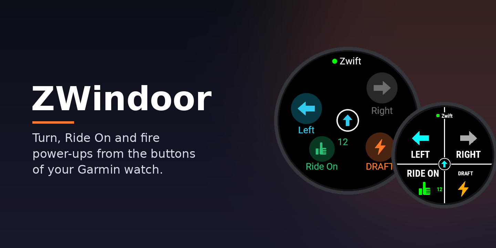
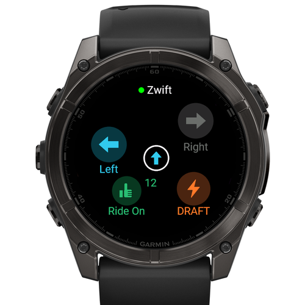
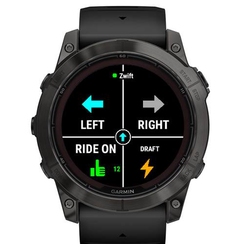
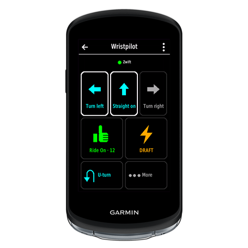
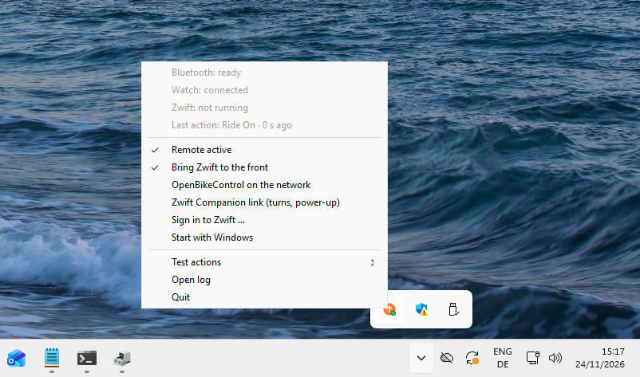

# ZWindoor

Your Garmin watch or Edge bike computer as a remote for Zwift.

  

Turn left or right at the next junction, go straight on, make a U-turn, give a Ride On or fire
your power-up – with the buttons of your watch, without letting go of the handlebar. Emotes, the
camera view and workout controls are one swipe away. Every command is confirmed on your wrist:
a short vibration when it arrived, a double vibration with the reason when it did not.

ZWindoor is an independent project, not affiliated with Zwift, Inc. or Garmin. Zwift is a
trademark of Zwift, Inc.

## Supported devices

| Type | Models | Layout |
|---|---|---|
| Watches with MIP display | fēnix 7 Pro family (7X Pro, 7 Pro, 7S Pro, with and without Wi-Fi) | four bold fields that stay readable in sunlight |
| Watches with AMOLED display | fēnix 8, 8 Pro, 9, 9 Pro, fēnix E, epix Pro (Gen 2) | coloured buttons next to the physical keys |
| Edge bike computers | Edge 530, 540, 550, 830, 840, 850, 1030 (incl. Plus and Bontrager), 1040, 1050, 1060, Explore 2, Explore 3, Edge MTB | big tiles in portrait mode |

<table>
<tr>
<td width="33%"></td>
<td width="33%"></td>
<td width="33%"></td>
</tr>
<tr>
<td align="center">AMOLED watches</td>
<td align="center">MIP watches</td>
<td align="center">Edge bike computers</td>
</tr>
</table>

## How it works

A Garmin watch can only act as a Bluetooth client (central). It cannot pose as a Zwift controller
or as a keyboard. ZWindoor therefore has two parts:

1. **The watch app** on your Garmin device sends your button presses over Bluetooth LE.
2. **The ZWindoor Bridge** on the computer that runs Zwift receives them and turns them into
   Zwift's keyboard shortcuts. It checks that Zwift is in front before it types anything and
   brings the Zwift window to the front if needed.

The bridge exists in two forms with the same core:

- **ZWindoor Bridge for Windows** – a small program in the notification area, a single .exe. It
  needs a second USB Bluetooth adapter of its own (about 10 euros, see below).
- **Built into [Tretlager](https://github.com/freiversum/tretlager)** – the Zwift manager for
  Linux, on its page *Watch remote*.

## Install

### Watch app

From the Connect IQ Store (coming soon):
`https://apps.garmin.com/apps/<STORE-ID>`

### Bridge on Windows 10/11

Download `ZWindoorBridge.exe` from the
[GitHub releases](https://github.com/freiversum/zwindoor/releases) and start it. No installation
is needed; settings and the log live in `%APPDATA%\Zwindoor\`. A checksum file
(`SHA256SUMS.txt`) is attached to every release.

The program is not code-signed yet, so Windows SmartScreen may warn on the first start.

**You need a second, dedicated USB Bluetooth adapter.** Windows advertises Bluetooth services
with a changing private address, and Garmin watches do not connect to such addresses. The bridge
therefore runs its own Bluetooth stack ([Bumble](https://github.com/google/bumble)) on a USB
adapter that it uses exclusively, with the adapter's fixed address. Your built-in Bluetooth stays
free for headphones, controllers and the like.

- Tested: TP-Link UB500 (Realtek RTL8761BU, about 10 euros). Other adapters with the Realtek
  RTL8761B chip should work too; the bridge loads their firmware itself.
- One-time setup: plug in the adapter, start [Zadig](https://zadig.akeo.ie/), choose
  *Options* | *List All Devices*, select the adapter (for the UB500: USB ID `2357 0604`), set
  the driver to **WinUSB** and click *Replace Driver*. Windows then no longer uses this adapter
  for its own Bluetooth.
- Start the bridge, or choose *Start Bluetooth again* in its menu if it was already running.

To give the adapter back to Windows, open the Device Manager, find it under *Universal Serial
Bus devices*, choose *Uninstall device* with *Attempt to remove the driver*, and plug it in again.

  

The menu shows the state of Bluetooth, the watch and Zwift, and the last action. *Test actions*
sends a command as if the watch had sent it, once Bluetooth is running.

### Bridge on Linux

Use [Tretlager](https://github.com/freiversum/tretlager). It includes the bridge and types into
Zwift running under Wine.

## Controls

The ride page is designed for blind use: buttons on the left turn left, buttons on the right turn
right. A short press triggers on release, a long press (600 ms) while you hold the button.

### Watches (fēnix, epix)

| Button | Short press | Hold |
|---|---|---|
| UP (left, 9 o'clock) | Turn left | Settings menu |
| START (right, 2 o'clock) | Turn right | U-turn |
| DOWN (left, 8 o'clock) | Ride On | Straight on |
| BACK (right, 4 o'clock) | Power-up | Exit |

Touch: swipe left or right to turn, swipe up for straight on, tap a quarter for its action, hold
anywhere for the power-up. Swipe down for the next page.

### Edge bike computers

| Button | Ride page |
|---|---|
| LAP (bottom left) | Turn left |
| START (bottom right) | Turn right (hold: U-turn) |
| ENTER | Straight on |
| UP | Ride On |
| DOWN | Power-up |
| BACK | Next page |

On touch models, tap the tiles: Left, Straight on, Right, Ride On, Power-up, U-turn and More.
ENTER, UP, DOWN and BACK exist on the button-only models (Edge 530/540/550, MTB).

### More pages

- **Actions:** elbow flick, wave, Nice, Hammer Time, bell, photo, camera view, HUD on/off
- **Workout:** easier, harder, skip interval (hold)

Full details per device: [watch/README.md](watch/README.md).

## Optional: Zwift Companion link

When switched on, the bridge connects to Zwift the way the Zwift Companion app on your phone does.
The watch then shows the junction ahead with the directions on offer, the power-up that is ready
and the Ride Ons you received. Turns, Ride On, power-ups, emotes and the camera go straight to the
game, without keyboard and without window focus.

**Please read before switching it on:**

- The link uses Zwift's undocumented relay and protocol. **Using it contradicts Zwift's terms of
  service.** It is off by default and you use it at your own risk.
- It needs your Zwift sign-in. ZWindoor never sees your password; the token is stored only on your
  computer (Windows: encrypted with your Windows account, Tretlager: in your keyring).
- Zwift allows one "phone" per account. While the link is on, it replaces the Companion app on
  your phone.

## Other trainer apps: OpenBikeControl

The bridge can offer your watch on the local network as an
[OpenBikeControl](https://openbikecontrol.org) controller. Trainer apps that support it, such as
MyWhoosh, TrainingPeaks Virtual or Incyclist, can then use the same buttons. Zwift itself does not
support OpenBikeControl; for Zwift the bridge types keyboard shortcuts.

## Privacy

ZWindoor collects no data. The watch talks only to the bridge on your own computer over Bluetooth.
There are no analytics, no crash reports and no servers of the developer. Only the optional
Companion link talks to Zwift, under Zwift's own privacy policy. Full text:
[docs/privacy.md](docs/privacy.md).

## Build from source

- [docs/building.md](docs/building.md) – tests, Windows build, watch app, Tretlager sync
- [docs/architecture.md](docs/architecture.md) – components and protocols
- [CHANGELOG.md](CHANGELOG.md), [BACKLOG.md](BACKLOG.md)

## Project page

- English: https://linuxundich.de/en/projects/zwindoor/
- German: https://linuxundich.de/projekte/zwindoor/

## Use of AI

ZWindoor was developed with AI assistance (Claude). Design decisions, testing on real devices and
releases are done by the author.

## License

GPL-3.0-or-later, see [LICENSE](LICENSE).
